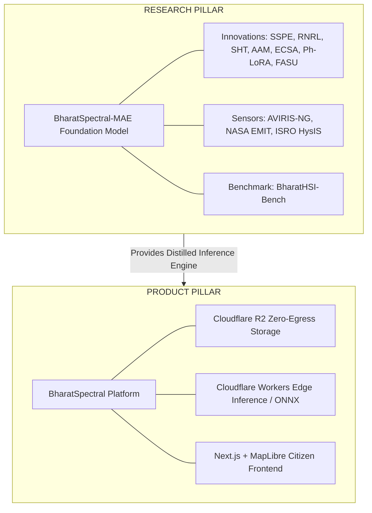

# Project Vision: BharatSpectral
## Democratized Spectral Intelligence for Indian Earth Observation Through Physics-Informed Foundation Modeling and Public Geospatial Infrastructure

---

## 1. Executive Summary & Dual-Pillar Framework
This capstone engineers a new category of geospatial capability — **Democratized Spectral-Semantic Intelligence (DSSI)** — through a synergistic Dual-Pillar Framework:

1. **The Research Pillar (Spectral Foundation Modeling):** Designs **BharatSpectral-MAE**, the first hyperspectral Foundation Model engineered for the spatial fragmentation, sub-pixel spectral mixing, and multi-season phenological complexity unique to Indian landscapes. 
2. **The Product Pillar (Spectral Public Infrastructure):** Builds the **BharatSpectral Platform**, a free, publicly accessible, citizen-facing WebGIS that embeds BharatSpectral-MAE as its inference engine. It delivers biochemical-grade spectral analytics as open Digital Public Infrastructure.



---

## 2. Core Problem Statements & Citizen Impact

Existing platforms provide biophysical intelligence (detecting stress). BharatSpectral provides **biochemical intelligence**:
*   **🌾 Precision Agriculture & Soil Health:** Detects nitrogen deficiency at 720 nm and maps Soil Organic Carbon via SWIR absorption 7–14 days before visible symptoms appear.
*   **🔥 Stubble Burning (Indo-Gangetic Plain):** Differentiates dry combustible crop residue from damp soil using SWIR moisture-absorption features to preempt burn events.
*   **💧 Inland Water Quality:** Isolates Chlorophyll-a, CDOM, and total suspended matter (TSM) with laboratory-grade specificity to monitor urban lakes and rivers.

---

## 3. Pillar 1: BharatSpectral-MAE & Research Innovations

Existing Foundation Models fail on Indian landscapes due to extreme spatial fragmentation (<0.5 ha plots), severe intercropping, multi-season phenology, and multi-sensor heterogeneity.

**BharatSpectral-MAE** solves this via seven named architectural innovations:

1.  **SSPE (Scale-Spectral Positional Encoding):** Jointly encodes spatial GSD, spectral bandwidth, and expected spectral mixture entropy.
2.  **RNRL (Reflectance-Normalized Reconstruction Loss):** Physics-informed normalization of self-supervised reconstruction by target reflectance magnitude.
3.  **SHT (Spectral Harmonic Tokenizer):** Sensor-adaptive 3D tokenizer dynamically adjusting spectral chunking by absorption-feature density.
4.  **AAM (Atmospheric Absorption Masking):** Structured masking simulating atmospheric water vapor and CO₂ interference to teach radiative transfer physics.
5.  **ECSA (Endmember-Constrained Self-Attention):** Regularizes self-attention using a spectral unmixing prior to attend to physically similar materials across fragmented plots.
6.  **Ph-LoRA (Phenology-Conditioned Low-Rank Adaptation):** Adapters dynamically modulated by crop growth stage and season embeddings (Kharif/Rabi/Zaid).
7.  **FASU (Foundation-Augmented Spectral Unmixing):** Sub-pixel unmixing head operating directly on pre-trained spectral representations.

---

## 4. Pillar 2: System Architecture & Cloud-to-Edge Triad

Three structural bottlenecks prevent public hyperspectral tools: Data volume, Egress costs, and Inference compute. BharatSpectral Platform solves these through:

```
[ Primary Data Sources ]
  • ISRO AVIRIS-NG (425 bands)
  • NASA EMIT (285 bands) & ISRO HysIS (220 bands)
  • Benchmark: BharatHSI-Bench
               │
               ▼
[ 1. Heavy AI Compute on AIRAWAT HPC ]
  • Distributed Multi-GPU Pre-training (A100s)
  • Pre-training BharatSpectral-MAE
  • Distillation to Lightweight ONNX Student Model
               │
               ▼
[ 2. Cloudflare Web Platform (Public Infrastructure) ]
  • Cloudflare R2: Zero-Egress Spectral Tile Streaming
  • Cloudflare Workers: Serverless Spectral Inference (SSI) via ONNX
  • Next.js / MapLibre: Citizen-Facing WebGIS Dashboard
               │
               ▼
[ 3. Optional: Google Coral Edge TPU ]
  • Quantized INT8 Student Model for offline drone telemetry
```

### Architectural Pillars:
1.  **AIRAWAT HPC Supercomputing:** Utilizes national DGX A100 GPU clusters for heavy pre-training of BharatSpectral-MAE and generating distillation pipelines.
2.  **Serverless Spectral Inference (SSI):** Executes a distilled lightweight student model directly on **Cloudflare Workers V8 isolates** using ONNX, solving memory constraints via spectral-spatial tiling.
3.  **Zero-Egress Spectral Tile Streaming:** Uses Cloudflare R2 and HTTP Range requests to stream sub-tiles to the client, dropping egress costs to near-zero.

---

## 5. Multi-Phase Engineering Roadmap

*   **Phase 1: Data Sourcing & BharatHSI-Bench** *(Completed)*
    *   Curate Indian multi-sensor datasets and export standardized Zarr/COGs.
    *   Establish BharatHSI-Bench (India's first open HSI agricultural benchmark).
*   **Phase 2: SOTA Baseline Failure Documentation**
    *   Evaluate SpectralGPT/HyperSIGMA on BharatHSI-Bench to quantify domain-shift degradation.
*   **Phase 3: BharatSpectral-MAE Pre-training & Distillation**
    *   Implement SSPE, RNRL, SHT, AAM, ECSA on AIRAWAT.
    *   Downstream Ph-LoRA / FASU fine-tuning.
    *   Model Distillation into a lightweight ONNX student model.
*   **Phase 4: BharatSpectral Platform (Cloudflare WebGIS)**
    *   Deploy Serverless Spectral Inference (SSI) on Cloudflare Workers.
    *   Zero-egress R2 streaming and Next.js / MapLibre frontend.
*   **Phase 5 (Optional): Offline Edge TPU Execution**
    *   Hardware-aware INT8 quantization for Google Coral.

---

## 6. Deliverable Standards & Visual Language
Every phase must produce a clean HTML Deliverable (`deliverables/phaseX.html`) adhering to:
*   **Palette:** Slate (`#0f172a`), deep sky blue (`#0284c7`), soft teal (`#0d9488`), and emerald accents.
*   **Typography:** Plus Jakarta Sans / Inter + JetBrains Mono for code.
*   **Diagrams:** High-contrast, spacious Mermaid.js flowcharts.
