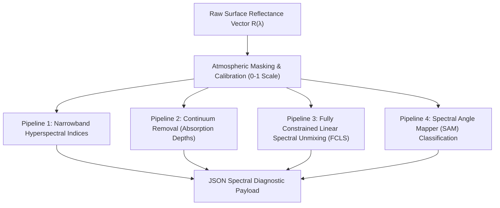

# BharatSpectral — Deterministic Hyperspectral Engine Plan

## Executive Summary
This document provides the complete, self-contained implementation blueprint for the **BharatSpectral Deterministic Hyperspectral Spectroscopy Engine**. 

Instead of treating spectral analysis as an opaque black-box neural network, this engine implements **deterministic, physically grounded radiative transfer and spectroscopic algorithms**. It takes calibrated Bottom-of-Atmosphere (BOA) surface reflectance vectors, applies atmospheric water vapor masking, and extracts diagnostic biochemical parameters (chlorophyll absorption wells, red-edge inflection shift, fractional endmember abundances, and residue/cellulose indices).

The engine is engineered in two synchronized tiers:
1. **Python Reference Core (`src/gis_spectroscopy/`):** For offline benchmarking, validation against USGS/JPL spectral libraries, and batch processing.
2. **TypeScript / Wasm Edge Port:** For sub-5ms in-isolate execution directly inside Cloudflare Workers or client-side in the browser.

---

## 1. Multi-Sensor Spectral Architecture & Wavelength Alignment

The engine dynamically ingests spectral vectors across four sensor fidelities without lossy resampling:

```text
┌────────────────────────────────────────────────────────────────────────┐
│                      SENSOR SPECIFICATION MATRIX                       │
├───────────────┬────────────┬─────────────┬───────────┬─────────────────┤
│ Sensor        │ Platform   │ Bands       │ Range     │ Nominal FWHM    │
├───────────────┼────────────┼─────────────┼───────────┼─────────────────┤
│ AVIRIS-NG     │ Airborne   │ 425 bands   │ 380–2510nm│ ~5.0 nm         │
│ NASA EMIT     │ ISS Orbit  │ 285 bands   │ 381–2493nm│ ~7.4 nm         │
│ ISRO HysIS    │ Satellite  │ 64 VNIR     │ 400–950nm │ ~10 nm          │
│               │            │ 256 SWIR    │ 900–2500nm│                 │
│ Sentinel-2    │ Satellite  │ 12 bands    │ 443–2190nm│ Broadband (ref) │
└───────────────┴────────────┴─────────────┴───────────┴─────────────────┘
```

### Atmospheric Absorption Masking (AAM)
To avoid false detections caused by atmospheric water vapor and carbon dioxide absorption, the engine applies hard radiometric masking:
* **Window 1 (Water Vapor):** $1350\,\text{nm} - 1440\,\text{nm}$ (Bands flagged as invalid/interpolated).
* **Window 2 (Water Vapor & $\text{CO}_2$):** $1800\,\text{nm} - 1950\,\text{nm}$ (Bands flagged as invalid/interpolated).
* **Signal-to-Noise Boundary:** Any reflectance $< 0.0$ (bad calibration) or $> 1.0$ (specular reflection artifact) is clamped or flagged.

---

## 2. Mathematical Algorithms & Formulation



### Pipeline 1: Narrowband Hyperspectral Indices

Hyperspectral narrowbands avoid the saturation effects seen in traditional broadband satellite indices:

1. **Normalized Difference Red Edge (NDRE):**
   $$\text{NDRE} = \frac{R_{790} - R_{720}}{R_{790} + R_{720}}$$
   *Biochemical diagnostic:* Sensitive to mid-to-high level canopy chlorophyll and nitrogen concentration where standard NDVI saturates ($> 0.7$).
2. **Photochemical Reflectance Index (PRI):**
   $$\text{PRI} = \frac{R_{531} - R_{570}}{R_{531} + R_{570}}$$
   *Biochemical diagnostic:* Reversible xanthophyll cycle epoxidation. Reflects photosynthetic light-use efficiency under diurnal heat and drought stress.
3. **Water Band Index (WBI):**
   $$\text{WBI} = \frac{R_{900}}{R_{970}}$$
   *Biophysical diagnostic:* Direct optical absorption of liquid water within plant cell vacuoles.
4. **Normalized Difference Tillage Index (NDTI) & Cellulose Absorption:**
   $$\text{NDTI} = \frac{R_{1660} - R_{2330}}{R_{1660} + R_{2330}}$$
   *Biophysical diagnostic:* Differentiates dry combustible crop residue (lignin/cellulose) from bare soil for stubble burning monitoring.
5. **MERIS Terrestrial Chlorophyll Index (MTCI):**
   $$\text{MTCI} = \frac{R_{753} - R_{708}}{R_{708} - R_{681}}$$
   *Biochemical diagnostic:* Red-edge inflection point proxy. Directly tracks cellular senescence.

---

### Pipeline 2: Diagnostic Continuum Removal (Absorption Wells)

Continuum removal isolates individual absorption features by fitting a convex hull to the local reflectance maxima:

$$\text{Continuum Line } R_c(\lambda) = \text{Upper Convex Hull of } R(\lambda)$$
$$R'(\lambda) = \frac{R(\lambda)}{R_c(\lambda)}$$
$$\text{Absorption Band Depth } D(\lambda) = 1 - R'(\lambda)$$

#### Targeted Absorption Windows:
* **Chlorophyll-$a$ Well ($650\text{--}700\,\text{nm}$, Center: $680\,\text{nm}$):**
  * Absorption Depth $D_{680} = 1 - R'(680)$.
  * Area Under Curve (AUC): $\int_{650}^{700} (1 - R'(\lambda)) \, d\lambda$.
* **Red-Edge Inflection Slope ($700\text{--}745\,\text{nm}$):**
  * Evaluates first derivative maximum $\frac{dR}{d\lambda}$ to identify the exact inflection wavelength $\lambda_{re}$.
  * Measures the "Blue Shift" ($\Delta \lambda_{re} < 0$) indicative of nitrogen chlorosis.
* **Cellulose & Lignin Feature ($2050\text{--}2150\,\text{nm}$, Center: $2100\,\text{nm}$):**
  * Critical for residue/dry biomass quantification.
* **Clay Mineral / Al-OH Hydroxyl Feature ($2180\text{--}2240\,\text{nm}$, Center: $2200\,\text{nm}$):**
  * Identifies illite, smectite, and sodic soil degradation.

---

### Pipeline 3: Fully Constrained Linear Spectral Unmixing (FCLS / LSU)

In Indian smallholder farms, average field sizes are $< 0.5\,\text{ha}$, meaning a single pixel often mixes multiple ground covers.

Let $E = [e_1, e_2, \dots, e_p] \in \mathbb{R}^{B \times p}$ be the endmember library of $p$ pure materials. For an observed pixel spectrum $y \in \mathbb{R}^B$:

$$y = E\alpha + \epsilon$$

Subject to:
1. **Abundance Non-Negativity Constraint (ANC):** $\alpha_i \ge 0, \quad \forall i \in \{1, \dots, p\}$
2. **Abundance Sum-to-One Constraint (ASC):** $\sum_{i=1}^p \alpha_i = 1$

The engine solves this quadratic programming problem:
$$\min_\alpha \frac{1}{2} \alpha^T (E^T E) \alpha - y^T E \alpha \quad \text{s.t.} \quad \alpha \ge 0, \quad \mathbf{1}^T \alpha = 1$$

#### Endmember Library Composition:
1. **$e_1$**: Pure Green Healthy Canopy (Chlorophyll-rich).
2. **$e_2$**: Stressed / Chlorotic Crop Canopy.
3. **$e_3$**: Dark Alluvial / Black Cotton Soil (Regur).
4. **$e_4$**: Dry Combustible Straw / Crop Residue.
5. **$e_5$**: Standing Water / Wet Soil.

---

### Pipeline 4: Spectral Angle Mapper (SAM) Similarity

Measures the spectral angle $\theta \in [0, \pi/2]$ between the unknown pixel vector $y$ and reference library signatures $e_k$:

$$\theta_k = \arccos\left( \frac{y \cdot e_k}{\|y\| \|e_k\|} \right)$$

* Output: Best matched material class and similarity confidence ($1 - \frac{\theta_k}{\pi/2}$).

---

## 3. Data Output Schema (The Engine-to-LLM Contract)

When the engine executes for a given pixel or polygon, it outputs a clean, typed JSON payload:

```json
{
  "sensor": {
    "name": "AVIRIS-NG India",
    "platform": "Airborne",
    "total_bands": 425,
    "valid_bands_used": 372,
    "wavelength_range_nm": [380.0, 2510.0],
    "ground_sampling_distance_m": 4.8
  },
  "coordinates": {
    "latitude": 21.1458,
    "longitude": 79.0882,
    "agro_ecological_zone": "Deccan Plateau (Rainfed Cotton-Soybean)"
  },
  "spectral_curve": {
    "wavelengths": [400.2, 405.3, "...", 2495.1],
    "reflectance": [0.038, 0.041, "...", 0.112]
  },
  "narrowband_indices": {
    "ndre": 0.284,
    "pri": -0.042,
    "wbi": 0.885,
    "ndti": 0.142,
    "mtci": 1.48
  },
  "continuum_diagnostics": {
    "chlorophyll_depth_680nm": 0.362,
    "chlorophyll_auc": 12.4,
    "red_edge_inflection_nm": 718.5,
    "red_edge_shift_nm": -9.5,
    "cellulose_depth_2100nm": 0.048,
    "clay_hydroxyl_depth_2200nm": 0.215
  },
  "subpixel_abundances": {
    "healthy_crop_fraction": 0.524,
    "stressed_crop_fraction": 0.142,
    "exposed_soil_fraction": 0.286,
    "dry_residue_fraction": 0.048,
    "reconstruction_rmse": 0.012
  },
  "sam_classification": {
    "top_match": "Gossypium hirsutum (Cotton)",
    "spectral_angle_rad": 0.082,
    "confidence_pct": 94.8
  }
}
```

---

## 4. Implementation Work Breakdown & Milestones

### Milestone E1: Python Reference Suite (`src/gis_spectroscopy/`)
* [ ] **Wavelength Calibration & Resampler (`src/gis_spectroscopy/wavelength_utils.py`)**:
  * Band interpolation for arbitrary sensor bandsets.
  * Water vapor window masking.
* [ ] **Absorption Depth & Red-Edge Tracker (`src/gis_spectroscopy/continuum_removal.py`)**:
  * Real convex hull continuum fitting using `scipy.spatial.ConvexHull` or rapid monotone chain.
  * Peak and well localization around 680 nm, 705 nm, 970 nm, 2100 nm, 2200 nm.
* [ ] **Narrowband Hyperspectral Index Calculator (`src/gis_spectroscopy/indices.py`)**:
  * Fast vectorized evaluation of NDRE, PRI, WBI, NDTI, MTCI.
* [ ] **Fully Constrained Least Squares (`src/gis_spectroscopy/linear_unmixing.py`)**:
  * Quadratic programming solver via `scipy.optimize.nnls` with sum-to-one constraint.
* [ ] **Endmember Library Ingestion (`data/processed/spectral_libraries/`)**:
  * Calibrated reference spectra for standard Indian crop and soil endmembers.
* [ ] **End-to-End Test Harness (`tests/test_spectroscopy_engine.py`)**:
  * Unit tests verifying math on synthetic and real AVIRIS-NG / EMIT pixel vectors.

### Milestone E2: TypeScript / WebAssembly Port for Cloudflare Workers
* [ ] Create pure TypeScript math utilities (`platform/workers/spectral-engine/`):
  * `convex-hull.ts` for continuum removal in V8 isolates (< 1 ms runtime).
  * `indices.ts` for all 5 narrowband formulas.
  * `fcls-unmixing.ts` using Active Set Method or lightweight NNLS in JS.
* [ ] Benchmark memory footprint in Cloudflare Worker runtime (target: < 15 MB RAM, < 10 ms execution).

---

## 5. Acceptance Criteria
1. **Continuum Removal Accuracy:** Absorption wells match laboratory USGS reference depths within $\pm 0.02$.
2. **FCLS Physical Validity:** Fractional abundances strictly sum to $1.000 \pm 0.001$, with zero negative fractions.
3. **Performance:** Single-pixel evaluation completes in $< 5\,\text{ms}$ on CPU / edge isolates.
4. **Zero-Hallucination Delivery:** All generated numbers are deterministic and reproducible from the raw reflectance array.
